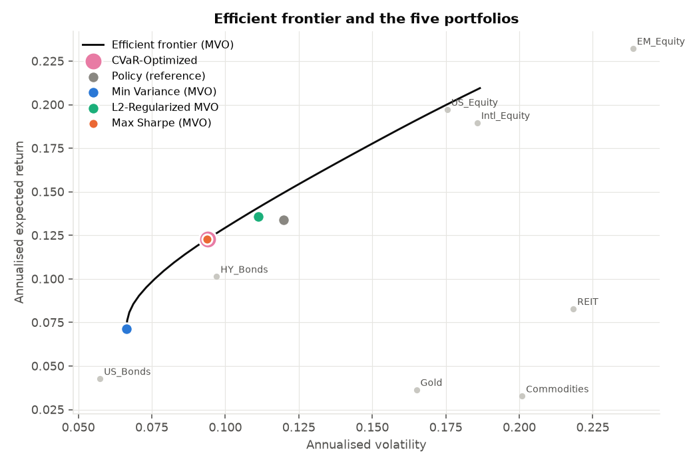
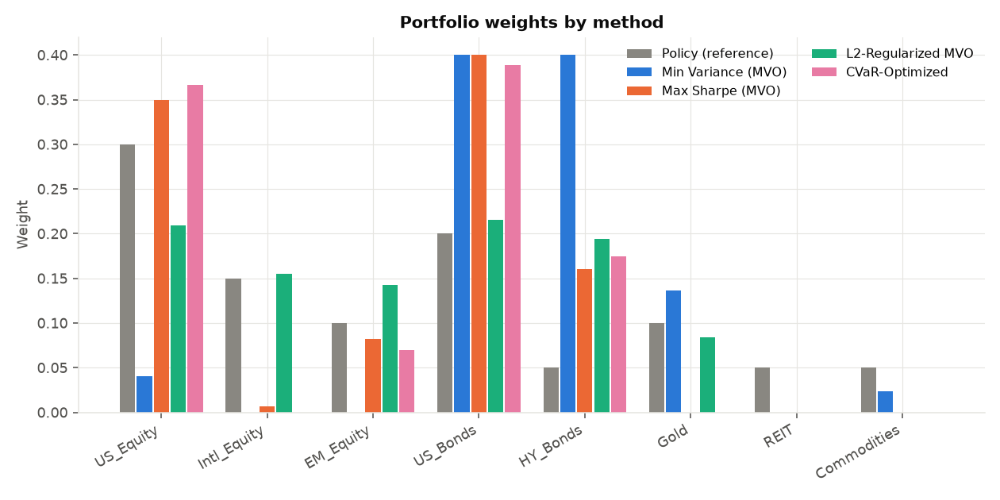
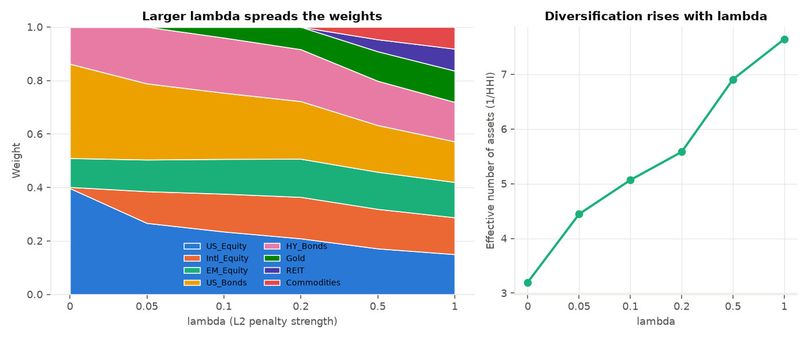
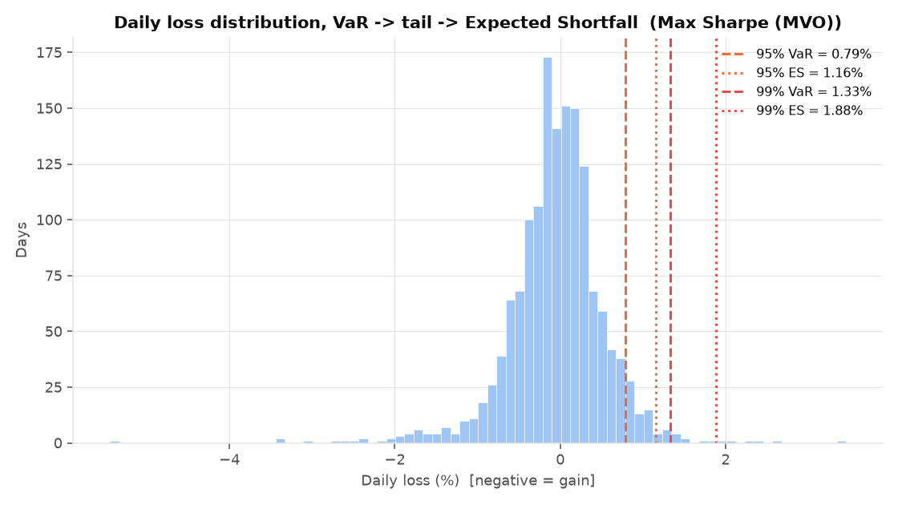
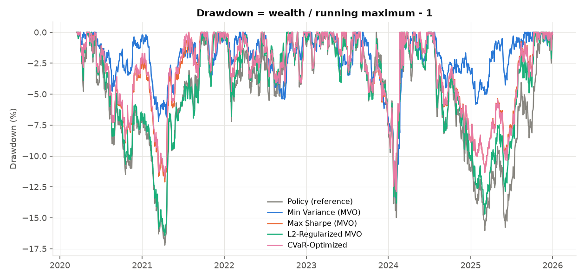
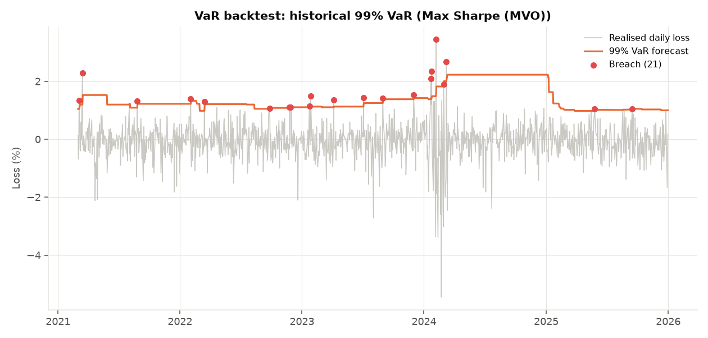
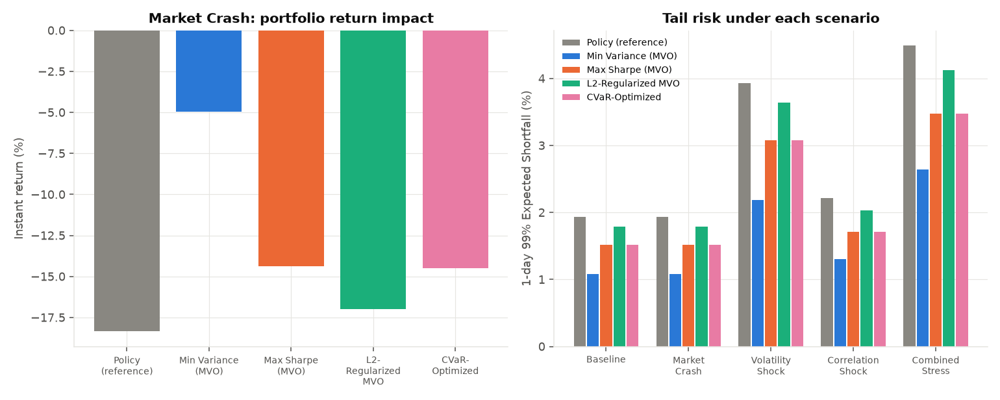

# GenAI-Powered Portfolio Optimization and Risk Analysis

A focused quantitative-finance project with four parts: **portfolio optimization** (3 methods), **risk analysis**, **validation / scenarios** (VaR backtesting and stress testing) and a simple **GenAI explanation layer** over the calculated results.

> **The quantitative calculations are performed deterministically using Python. Generative AI is used as an interpretation and natural-language explanation layer.**

There is **no agentic AI** here: no agents, no planner, no tool calling, no RAG, no vector database. GenAI receives already-calculated results in a single prompt and explains them.

```text
Market Data (simulated, or your own CSV)
        ↓
Python Quantitative Engine
        ↓
Optimization  +  Risk  +  VaR Backtest  +  Scenarios
        ↓
Calculated Results  (outputs/results.json)
        ↓
GenAI  (one prompt: results + question)
        ↓
Natural-Language Explanation  (+ automatic check that every number is traceable)
```

## Quick start

```bash
pip install -r requirements.txt
python run_analysis.py                      # runs everything -> outputs/tables, outputs/figures, outputs/results.json
python ask.py "Explain my portfolio risk."  # GenAI explanation (offline templates if no API key)
python ask.py --list                        # the 10 example questions
python tests/run_tests.py                   # or: pytest tests/
```

To use the real LLM: `export ANTHROPIC_API_KEY=...` (optional `LLM_MODEL=...`, default `claude-sonnet-5-5`). Without a key, `ask.py` falls back to fixed offline templates filled with the same calculated numbers, so the project always runs.

## Project structure

```text
run_analysis.py            run the full pipeline, write tables / charts / results.json
ask.py                     command-line GenAI question answering
src/portfolio_risk/
  config.py                ALL assumptions in one place (risk-free rate, weight cap, lambda, seeds, scenarios)
  simulate_data.py         reproducible 8-asset simulated market data (+ CSV loader for real data)
  optimization.py          Mean-Variance (GMV, Max Sharpe, frontier), L2-regularised MVO, CVaR optimisation
  risk_metrics.py          volatility, Sharpe, Historical VaR, Monte Carlo VaR, Expected Shortfall, drawdown
  backtesting.py           rolling VaR forecasts, breach counts, Kupiec test
  scenarios.py             scenario engine (crash, volatility shock, correlation shock, combined)
  pipeline.py              glues the above together -> results dict
  plots.py                 charts
  genai_explainer.py       context builder, prompt, LLM call, number check, offline templates
tests/                     25 tests (optimisation, risk, backtest, scenarios, GenAI)
docs/                      architecture.md, INTERVIEW_GUIDE.md
```

## Data

Six years of daily returns (1,512 days, 2020-03-17 to 2025-12-31) for 8 assets (US/Intl/EM equity, US bonds, HY bonds, gold, REIT, commodities), drawn from a fat-tailed multivariate Student-t with a fixed seed, so every number in this README is reproducible. A 40-day stress regime (3× volatility, falling equities, correlations near 0.9) is embedded so the backtest has a real tail event. **The data is simulated** - swap in real prices with `simulate_data.load_returns_csv(...)`; nothing else changes.

---

## A. Portfolio optimization

All three methods share identical constraints, so differences come from the *objective*, not the rules:

`sum(w) = 1` (fully invested), `0 ≤ wᵢ ≤ 40%` (long-only, no asset above 40%). Solver: SLSQP (CVaR uses a linear program).

Inputs: `μ` = mean daily return × 252, `Σ` = daily covariance × 252.

### 1. Mean-Variance Optimization (Markowitz)

| Portfolio | Objective |
|---|---|
| Global Minimum Variance | minimise `wᵀΣw` |
| Maximum Sharpe | maximise `(wᵀμ − r_f) / √(wᵀΣw)` |
| Efficient frontier | for each target return, minimise `wᵀΣw` s.t. `wᵀμ = target` |

Portfolio return `R_p = wᵀμ`, volatility `σ_p = √(wᵀΣw)`, Sharpe `= (R_p − R_f)/σ_p` with `R_f` = 2%.

### 2. L2-regularised MVO

```
minimise   γ · wᵀΣw  −  wᵀμ  +  λ · ‖w‖²          (γ = 5, λ = 0.2)
              risk      return     concentration penalty
```

- Plain MVO can produce **concentrated** portfolios (Max Sharpe puts 40% in one asset and ~0% in half the universe) because it chases small differences in noisy estimated returns.
- `‖w‖² = Σwᵢ²` is smallest when weights are equal, so the **L2 penalty makes big weights expensive**.
- **λ controls the strength**: λ = 0 is plain mean-variance utility; larger λ → more evenly spread weights (limit: 1/N).

| lambda | Return | Vol | Sharpe | Largest weight | Effective N |
|---|---|---|---|---|---|
| 0.0 | 13.32% | 10.37% | 1.09 | 39.67% | 3.20 |
| 0.05 | 13.62% | 10.76% | 1.08 | 28.47% | 4.44 |
| 0.1 | 13.62% | 10.95% | 1.06 | 24.75% | 5.07 |
| 0.2 | 13.56% | 11.13% | 1.04 | 21.53% | 5.58 |
| 0.5 | 12.75% | 11.46% | 0.94 | 17.48% | 6.91 |
| 1.0 | 12.15% | 11.75% | 0.86 | 15.22% | 7.64 |

`Effective N = 1/Σwᵢ²` is the "equivalent number of equally-weighted assets". Note the L2 portfolio is *not* free: larger λ gives up Sharpe (1.09 → 0.86 across the grid). Row λ = 0 is the utility version of MVO (fixed risk aversion), which is why it differs slightly from the Max-Sharpe portfolio.

### 3. CVaR optimisation

- **VaR** is a loss *threshold*. **CVaR / Expected Shortfall** is the *average loss beyond* that threshold. CVaR optimisation builds the portfolio that keeps this tail average small.
- Formulation (Rockafellar & Uryasev, 2000), one practical version only: minimise the 95% CVaR of historical portfolio losses subject to the same weight constraints **and** an expected return of at least that of the Max-Sharpe portfolio (12.28%). It is a linear program, so it is solved exactly (global optimum). Fixing the return makes the comparison fair: *same return, which portfolio has the smaller tail?*

Resulting weights:

| Asset | Policy (reference) | Min Variance (MVO) | Max Sharpe (MVO) | L2-Regularized MVO | CVaR-Optimized |
|---|---|---|---|---|---|
| US_Equity | 30.0% | 4.0% | 35.0% | 20.9% | 36.6% |
| Intl_Equity | 15.0% | 0.0% | 0.7% | 15.5% | 0.0% |
| EM_Equity | 10.0% | 0.0% | 8.3% | 14.3% | 7.0% |
| US_Bonds | 20.0% | 40.0% | 40.0% | 21.5% | 38.9% |
| HY_Bonds | 5.0% | 40.0% | 16.1% | 19.4% | 17.5% |
| Gold | 10.0% | 13.6% | 0.0% | 8.4% | 0.0% |
| REIT | 5.0% | 0.0% | 0.0% | 0.0% | 0.0% |
| Commodities | 5.0% | 2.3% | 0.0% | 0.0% | 0.0% |





**Honest note:** on this simulated (roughly symmetric) data, CVaR optimisation and Max-Sharpe give almost the same portfolio (95% ES 1.16% for both; CVaR is marginally lower). CVaR optimisation pays off when returns are skewed or heavily fat-tailed (real markets), where variance is a poor proxy for tail loss. Optimisation is done in-sample; see *Limitations*.

---

## B. Portfolio risk

All numbers below are for **1-day** horizons, as a % of portfolio value (losses are positive).

| Portfolio | Return | Vol | Sharpe | Hist VaR95 | MC VaR95 | ES95 | Hist VaR99 | MC VaR99 | ES99 | Max DD | Eff. N |
|---|---|---|---|---|---|---|---|---|---|---|---|
| Policy (reference) | 13.38% | 11.98% | 0.95 | 1.03% | 1.19% | 1.50% | 1.74% | 1.69% | 2.45% | -17.21% | 5.56 |
| Min Variance (MVO) | 7.13% | 6.64% | 0.77 | 0.56% | 0.66% | 0.88% | 1.04% | 0.94% | 1.46% | -13.35% | 2.93 |
| Max Sharpe (MVO) | 12.28% | 9.39% | 1.10 | 0.79% | 0.93% | 1.16% | 1.33% | 1.32% | 1.88% | -12.89% | 3.17 |
| L2-Regularized MVO | 13.56% | 11.13% | 1.04 | 0.97% | 1.10% | 1.39% | 1.57% | 1.57% | 2.24% | -16.42% | 5.58 |
| CVaR-Optimized | 12.28% | 9.39% | 1.09 | 0.80% | 0.93% | 1.16% | 1.35% | 1.32% | 1.88% | -12.89% | 3.12 |

| Metric | Definition |
|---|---|
| Volatility | `σ_p = √(wᵀΣw)` (annualised) |
| Sharpe | `(R_p − R_f) / σ_p` |
| Historical VaR (95%) | the 95th percentile of the portfolio's actual daily losses: on 95% of days the loss was smaller than this |
| Monte Carlo VaR | see below |
| Expected Shortfall / CVaR | average loss on the worst `(1−α)` of days |
| Maximum drawdown | worst peak-to-trough fall: `drawdown = wealth / running_max − 1` |

**VaR → tail → Expected Shortfall.** Sort all daily losses. VaR₉₅ is the cut-off where the worst 5% of days begin. Those worst 5% of days are the *tail*. ES₉₅ is the *average of the tail*, so it is always ≥ VaR and it "sees" how severe the bad days are. For Max Sharpe: VaR₉₉ = 1.33% but ES₉₉ = 1.88%.



**Monte Carlo VaR** (kept deliberately simple, seed = 42, 100,000 simulations):
1. Estimate each asset's mean return and the covariance matrix from history.
2. Simulate correlated asset returns `μ + L·z` (`L` = Cholesky factor of Σ, `z` standard normal).
3. Multiply by the weights → a distribution of simulated portfolio losses.
4. VaR = the α-quantile; ES = average of the losses beyond it.

Because the simulation assumes a **normal** distribution, its 99% ES (1.51% for Max Sharpe) is lower than the historical 99% ES (1.88%): real returns have fatter tails. A good talking point.

**Maximum drawdown** uses the running maximum of the wealth curve:



## C. VaR backtesting

> "I compared the predicted VaR threshold with actual subsequent losses and counted how frequently the realized losses exceeded the VaR estimate."

For each day, forecast a 1-day VaR from only the previous 250 days (no look-ahead) and check whether the next day's loss exceeded it (a **breach**). A correct 99% VaR should be breached on ~1% of days. The **Kupiec proportion-of-failures test** asks whether the observed breach rate is statistically different from expected (p < 0.05 ⇒ model rejected). Both the historical VaR and the (simple, normal) Monte Carlo VaR are backtested. Results for Max Sharpe:

| VaR method | Confidence | Breaches | Breach rate | Expected | Kupiec p-value | Verdict |
|---|---|---|---|---|---|---|
| historical | 95% | 61 / 1262 | 4.83% | 5.00% | 0.785 | consistent |
| historical | 99% | 21 / 1262 | 1.66% | 1.00% | 0.030 | reject |
| monte_carlo | 95% | 46 / 1262 | 3.65% | 5.00% | 0.021 | reject |
| monte_carlo | 99% | 17 / 1262 | 1.35% | 1.00% | 0.239 | consistent |

Interpretation: the 95% historical VaR is well calibrated. The 99% historical VaR is breached too often (1.66% vs 1%) - the embedded stress regime produces clusters of breaches in early 2024 (chart) because a 250-day window of calm days under-predicts a sudden volatility jump. The normal Monte Carlo VaR is too conservative at 95% (3.65% breaches vs 5% expected): fat-tailed returns are more peaked than a normal curve, so a normal-based 95% cut-off sits further out than the true 95% quantile. At 99% it is acceptable.



## D. Scenario engine

Every scenario is three knobs: an instant **price shock**, a **volatility multiplier**, a **correlation shock**. All are defined in `config.py`.

| Scenario | What changes |
|---|---|
| Market Crash | instant price shock: equities −28% to −35%, REIT −32%, HY −15%, commodities −18%, bonds +4%, gold +8% |
| Volatility Shock | every asset's volatility × 2 |
| Correlation Shock | correlations moved 50% of the way toward 0.90 (diversification fades) |
| Combined Stress | Market Crash + Volatility Shock + Correlation Shock |

For every scenario the engine reports the **return impact** (`wᵀ·shock`), the **loss** in dollars, the **stressed volatility, VaR and ES** (Monte Carlo with the same seed as the baseline, so changes come *only* from the scenario) and the **change versus baseline**. Vol/correlation shocks don't move prices; their impact shows up in the stressed risk metrics. Max Sharpe:

| Scenario | Return impact | Loss ($1m) | Vol | VaR99 | ES99 | Δ ES99 vs base |
|---|---|---|---|---|---|---|
| Baseline | 0.00% | $0 | 9.39% | 1.32% | 1.51% | +0.00 pp |
| Market Crash | -14.39% | $143,860 | 9.39% | 1.32% | 1.51% | +0.00 pp |
| Volatility Shock | 0.00% | $0 | 18.77% | 2.69% | 3.08% | +1.56 pp |
| Correlation Shock | 0.00% | $0 | 10.60% | 1.49% | 1.72% | +0.20 pp |
| Combined Stress | -14.39% | $143,860 | 21.20% | 3.03% | 3.48% | +1.97 pp |

Market Crash impact and combined-stress tail risk for all portfolios:

| Portfolio | Crash return | Loss ($1m) | Combined-stress ES99 |
|---|---|---|---|
| Policy (reference) | -18.35% | $183,500 | 4.49% |
| Min Variance (MVO) | -4.94% | $49,435 | 2.64% |
| Max Sharpe (MVO) | -14.39% | $143,860 | 3.48% |
| L2-Regularized MVO | -16.99% | $169,870 | 4.12% |
| CVaR-Optimized | -14.51% | $145,069 | 3.47% |



---

## E. GenAI explanation layer

**Why GenAI?** The quantitative engine generates portfolio, risk, optimization and scenario results, but interpreting those results can be difficult for users who aren't familiar with quantitative finance. I added GenAI as a natural-language explanation layer so users can ask questions about the calculated results and understand the implications without changing the underlying numerical calculations.

How it works (`src/portfolio_risk/genai_explainer.py`, ~200 lines):

1. `build_context()` turns `results.json` into a compact, rounded JSON of every calculated number (percent units, 2 decimals).
2. **One** request goes to the LLM: a system prompt (use only numbers from the results; never invent, estimate or recompute; explain in plain English; no investment advice) + the results + the user's question.
3. `check_numbers()` scans the answer and **flags any figure that cannot be traced to the results** (correct rounding is accepted). `ask.py` prints a warning if something is untraceable.
4. No API key or a failed call → `offline_explain()` answers from fixed templates filled with the same numbers (plain string formatting, not GenAI).

Questions supported (all ten work offline and with the LLM):

- Explain my portfolio risk. · Explain the Monte Carlo VaR. · What does my Expected Shortfall mean?
- Why is the maximum Sharpe portfolio different from the minimum variance portfolio?
- Compare MVO and CVaR optimization. · Why did the L2 portfolio have different weights?
- Which portfolio has lower tail risk? · Explain the VaR backtesting result.
- What happens under the market crash scenario? · Explain the difference between VaR and CVaR.

Example (offline mode): `python ask.py "What does my Expected Shortfall mean?"`

> Expected Shortfall (ES, also called CVaR) is the average loss on the worst days beyond the VaR threshold. For Max Sharpe (MVO): 95% ES = 1.16% (the average loss on the worst 5% of days) and 99% ES = 1.88% (worst 1%), compared with the 99% VaR of 1.33%. The gap between VaR and ES shows how heavy the tail is. …

---

## Limitations (say these before the interviewer does)

- **Simulated data.** Numbers show the methodology works, not that a strategy makes money. Use `load_returns_csv` for real data.
- **In-sample optimisation.** Weights are fitted and evaluated on the same history, so Sharpe ratios look better than they would out of sample (the reason L2 regularisation and weight caps exist). A walk-forward test was deliberately left out to keep the scope focused.
- **Expected returns are noisy** sample means; MVO is very sensitive to them.
- **Monte Carlo assumes normality**, so it understates tail risk relative to historical (shown above).
- **Scenarios are hypothetical** and hand-set, not forecasts.
- **The LLM was not run against the live API in the build environment** (no key/network); the API path is tested with a fake client, and the offline path is exercised for all 10 questions.

## What was removed from the original project

Agents/orchestrator/guardrails/memory, RAG knowledge base and retriever, the tool-schema layer, Ledoit-Wolf shrinkage MVO, dynamic/rolling MVO, factor-risk and liquidity-risk modules, walk-forward optimisation comparison, and parametric/Student-t VaR variants. The data simulator, historical VaR/ES, Kupiec backtest, drawdown and scenario ideas were kept and simplified.

## Tests

`pytest tests/` (or `python tests/run_tests.py`): constraints hold for all optimisers; GMV has the lowest volatility and Max Sharpe the highest Sharpe (checked against thousands of random portfolios); L2 concentration falls monotonically with λ; the CVaR optimum beats random feasible portfolios and meets the return target; VaR/ES/drawdown/Kupiec on hand-computed examples; Monte Carlo reproducibility and agreement with the closed-form normal VaR; scenario formulas; the GenAI prompt contains the results and rules, invented numbers are flagged, failures fall back gracefully, and the project contains no agentic components.
